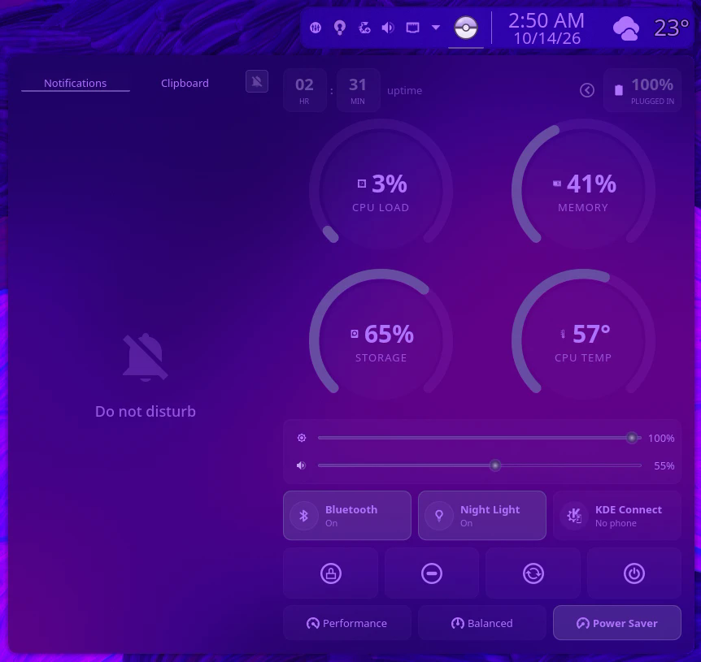

# Nyx Control

A control center for the KDE Plasma 6 panel. Notifications, clipboard, system gauges, quick toggles and power controls all live in one popup.

All colors come from your active Plasma theme, so it matches whatever theme you use.



## Features

- **Notifications tab:** history grouped by app, dismiss one or clear all. The bell toggles Do Not Disturb.
- **Clipboard tab:** your clipboard history.
- **Gauges:** ring meters for CPU load, memory, storage (the `/` partition) and CPU temperature, plus uptime and battery level.
- **Sliders:** screen brightness and volume (click the speaker to mute).
- **Quick tiles:**
  - **Bluetooth:** shows the connected audio device
  - **Night Light**
  - **KDE Connect:** shows your phone's battery and has a ring-my-phone button
- **Power profile:** Performance / Balanced / Power Saver.
- **Session buttons:** lock, sleep, log out, restart, shut down.
- **Settings:** a configurable panel icon.

## Requirements

- KDE Plasma 6 (tested on 6.7.5)
- `ksystemstats` for the gauges, which Plasma already includes
- `power-profiles-daemon` for the power profile buttons
- WirePlumber (`wpctl`) for volume
- Optional: `bluez-qt` + Bluetooth, and KDE Connect for those tiles

## Install

```bash
git clone https://github.com/OthrineTM/nyx-control.git
kpackagetool6 --type Plasma/Applet --install nyx-control/package
```

Then right-click your panel → **Add or Manage Widgets…**, search for **Nyx Control**, and drag it onto the panel.

**Update:** `git pull`, then `kpackagetool6 --type Plasma/Applet --upgrade nyx-control/package`, then `systemctl --user restart plasma-plasmashell`.

**Remove:** `kpackagetool6 --type Plasma/Applet --remove io.github.othrinetm.nyxcontrol`

## Notes

The widget uses some of Plasma's private QML modules (sessions, brightness, clipboard), the same ones the built-in widgets use. A big Plasma update could break them.

## License

GPL-3.0-or-later. See [LICENSE](LICENSE).
